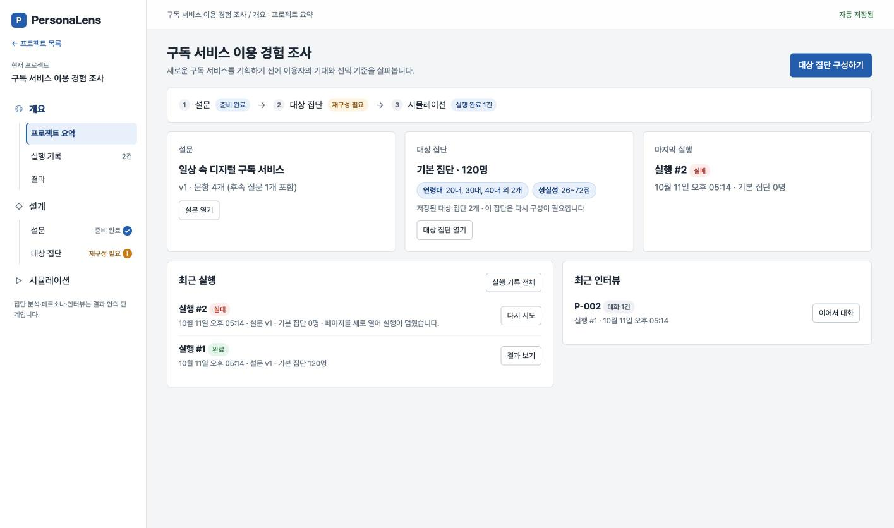
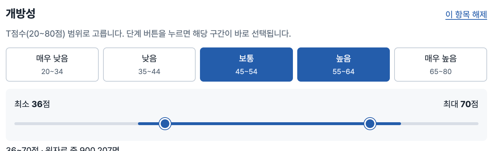
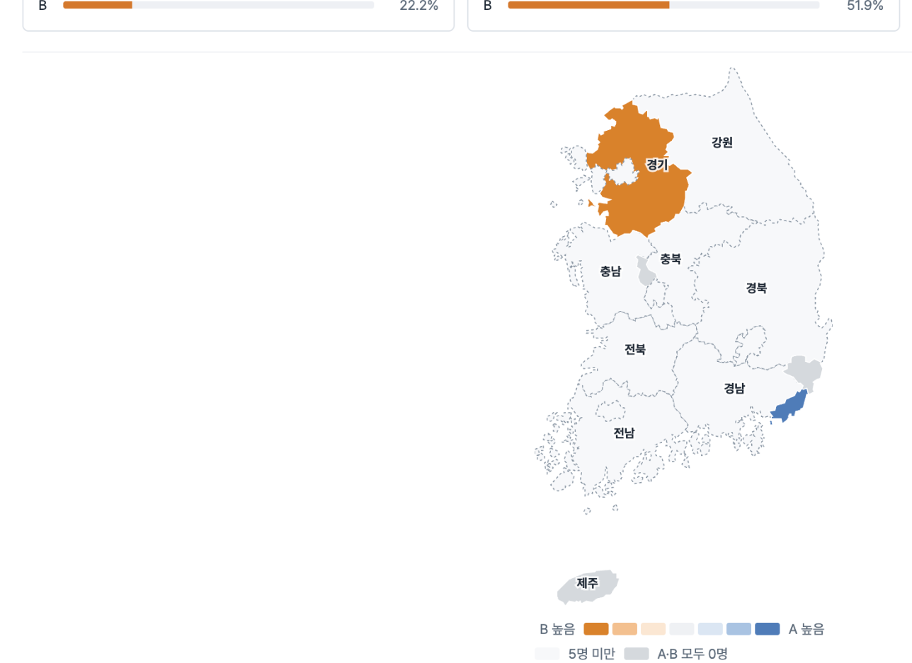

<p align="center">
  <b>PersonaLens</b><br>
  합성 페르소나로 설문 응답을 시뮬레이션하는 연구용 프로토타입입니다
</p>

<p align="center">
  
</p>

<p align="center">
  <a href="#로컬-실행">로컬 실행</a> ·
  <a href="docs/development.md">개발 문서</a> ·
  <a href="backend/README.md#docker로-로컬-배포-검증">Docker 배포 준비</a> ·
  <a href="docs/CHANGELOG.md">변경 기록</a>
</p>

## 문제에서 시작했습니다

합성 페르소나로 설문 응답을 만들면 문항별 응답 평균은 어느 정도 맞출 수 있습니다. 하지만 문항 사이의 관계, 예를 들어 집값 안정화 정책에 찬성한 사람이 증세 문항에는 어떻게 답하는가는 잘 재현하지 못합니다. 연구자가 합성 데이터를 조사 설계나 사전 검토에 쓰려면, 평균이 맞는 것과 별개로 이 관계가 얼마나 재현되는지 직접 들여다볼 수 있어야 합니다.

> 평균은 맞아도, 관계는 다른 이야기입니다.

## 그래서 이렇게 풀었습니다

PersonaLens는 그 재현 정도를 연구자가 직접 설계하고 들여다볼 수 있게 만든 첫 단계 프로토타입입니다. 설문과 대상 집단을 직접 구성해 합성 응답을 생성하고, 전체 응답부터 집단 간 비교, 개별 페르소나의 답변까지 같은 화면에서 탐색할 수 있습니다.

## 핵심 경험

### 1. 설문을 설계합니다

문항을 추가하고 순서를 바꾸고, 필요하면 후속 질문(Q1-1)을 답니다. 설문을 수정하는 동안은 버전이 올라가지 않고 "편집 중"으로 표시되며, 실행할 때 버전이 확정됩니다.

### 2. 대상 집단을 구성합니다

연령·지역·Big5 성격 점수 등의 조건으로 대상 집단을 만들고, 조건을 바꿀 때마다 해당하는 인원이 실시간으로 바뀝니다.

<p align="center">
  
</p>

### 3. 시뮬레이션을 실행합니다

실행 전에 설문·대상 집단·예상 응답 수를 확인합니다. 실행 중에도 다른 화면으로 이동할 수 있고, 끝나면 알림이 뜹니다. 실패하면 다시 시도할 수 있습니다.

### 4. 결과를 탐색합니다

전체 응답 분포에서 시작해 특정 응답으로 집단을 좁혀 가며(집단 분석) 속성별 차이를 봅니다. 지역(시·도)으로 나누면 지도로도 볼 수 있고, 선택지 두 개를 골라 두 응답자 집단의 속성 차이를 바로 비교할 수도 있습니다.

<p align="center">
  
</p>

### 5. 페르소나를 들여다봅니다

응답자 개개인(페르소나)의 속성과 답변을 보고, 특정 응답에 대해 질문을 던지면 그 응답을 인용한 답변을 받습니다.

## 구현된 기능

- 프로젝트 여러 개 관리, 기존 데이터 보존하며 예시 프로젝트 추가
- 설문 설계: 버전 관리, 후속 질문, 문항 순서 변경, 입력 중 오류 검사
- 대상 집단: 조건 팝업(연령·지역·Big5 등), 집단 여러 개 동시 관리, 실시간 인원 추정
- 모델 연결: 로그인, 개인·연구실 공용 OpenAI/Anthropic/DGX 등록, 키 암호화, 모델 목록 조회·선택 저장
- 시뮬레이션: 최대 10,000명, 시연/OpenAI 실제 응답, 서버 처리 건수 기반 진행률 바, 취소·실패분 재시도, 완료 후 결과 바로가기
- 후속 인터뷰: 실행 당시 프로필·설문 응답·이전 대화를 참조하는 OpenAI 인터뷰, DB 저장 및 새로고침 복원
- 결과: 전체 응답 분포, 집단 분석(표·차트·지도), 선택지별 응답자 비교, 페르소나 목록·상세·인터뷰, CSV 내보내기(wide·long·codebook)

## 기술 구성

| 영역 | 기술 |
| --- | --- |
| 화면 | React, Vite, React Router |
| 상태 관리 | Zustand (immer), API 자동 저장 |
| 백엔드 | Python 3.12+, FastAPI, SQLAlchemy, Alembic |
| 테스트 | Vitest, pytest + PostgreSQL 통합 테스트 |
| 데이터 저장 | 프로젝트·설문·대상집단·실행·응답: PostgreSQL 18 |
| 작업 실행 | 별도 Python 워커, PostgreSQL 작업 큐·임대·체크포인트 |
| 인증·연결 | HttpOnly 세션 쿠키, 사용자별 권한, Fernet API 키 암호화 |

## 로컬 실행

컨테이너로 실행하려면 [Docker 배포 준비](backend/README.md#docker로-로컬-배포-검증)를 참고하세요. 기존 개발 서버와 별도 DB·8080 포트를 사용하며, 원본 Parquet는 읽기 전용으로 연결합니다. 기본 `local` 모드는 시연 응답이며, [OpenAI 실제 실행 모드](backend/README.md#로컬-docker에서-openai-실제-응답)에서는 연결 화면에 입력한 키로 실제 응답을 생성합니다.

```
npm ci
bash scripts/dev-db.sh start
# 별도 터미널: cd backend && uv sync --locked --python 3.12
#              uv run python scripts/init_secrets.py
#              uv run alembic upgrade head
#              uv run uvicorn app.main:app --host 127.0.0.1 --port 8000
# 또 다른 터미널: cd backend && uv run python -m app.worker
npm run dev      # 프론트 개발 서버 (API 서버 필요)
npm run dev:demo # 서버 없이 기존 로컬 시연 모드
npm run build    # 프로덕션 빌드
npm run preview  # 빌드 결과 미리 보기
npm test         # Vitest (원본 대비 회귀 테스트 포함)
```

첫 접속에서 관리자 계정을 만듭니다. 기존 DB 프로젝트와 실행은 첫 관리자에게 귀속되고, 새 DB는 빈 목록으로 시작합니다. 기본 모드에서 프로젝트·설문·대상집단·모델 선택은 DB에 자동 저장됩니다. 상단의 “DB에 저장됨”을 확인하면 새로고침 후에도 복원됩니다. “예시 프로젝트 추가”와 이전 브라우저 데이터(`personascope-proto-v4`) 가져오기도 유지합니다. 자세한 실행 방법과 API 명세는 [백엔드 문서](backend/README.md)를 참고하세요.

상단 ‘모델 연결’에서 OpenAI·Anthropic API 키 또는 DGX의 OpenAI 호환 서버를 등록하고 목록을 조회합니다. ‘설계 → 응답 모델’에서 연결별 모델을 선택합니다. 키는 서버에 암호화해 저장합니다. 실제 키 없이 확인하려면 [가짜 키·모의 서버 검증](backend/README.md#실제-키-없는-모의-서버-검증)을 사용하세요. **모델 목록 조회와 선택까지 구현되어 있으며 시뮬레이션은 계속 시연 생성기를 사용합니다.**

실행하면 설문과 대상집단이 고정되어 DB에 저장되고, 별도 워커가 시연 응답을 생성합니다. DB와 워커가 켜져 있으면 브라우저를 닫아도 계속 처리되며, 다시 열면 실행 기록과 결과가 복원됩니다. 중단된 워커를 다시 실행하면 미완료 작업을 이어서 처리합니다.

`legacy/`의 바닐라 JS 프로토타입(v4)을 기능·화면·문구·동작 그대로 React + Vite로 옮긴 버전입니다. 원본은 `legacy/index.html`을 브라우저로 직접 열면 됩니다(서버 불필요).

## 지금의 한계

실제 서비스가 아닌 시연용 프로토타입이라 다음과 같은 한계가 있습니다.

- **응답은 시연 생성기가 만든 가짜 데이터**입니다. 서버 생성기는 고정된 입력의 해시로 재현 가능한 값을 만들며, 실제 여론을 반영하지 않습니다.
- **서버 모드 대상 집단**은 설정한 Parquet 실제 레코드를 조회·추출합니다. 로컬 시연 모드만 기존 근사치와 시연 프로필을 사용합니다. 원본 설정은 [백엔드 문서](backend/README.md#parquet-원본-대상-집단)를 참고하세요.
- **서술형 조건**은 서버 모드에서 원본 문자열 포함 검색으로 적용됩니다. 로컬 시연 모드에는 서술 내용이 없습니다.
- **직업 대분류**는 매핑 데이터가 없어 분석용 속성에서 제외했습니다.
- **인터뷰 답변은 템플릿**입니다. AI API와 연결되어 있지 않습니다.
- **이전 로컬 시연 기록·템플릿 인터뷰는 브라우저에 저장**됩니다. 새 서버 실행과 응답은 DB에서 복원됩니다.
- **현재 백엔드는 로컬 개발용**입니다. 로그인·소유자 권한은 구현했으며, 실제 모델 추론·공유 배포용 운영 설정·계정 복구는 후속 단계입니다.
- **다크 모드는 지원하지 않습니다.**

## 앞으로 할 일

아직 구현하지 않은 계획입니다.

- 문항 사이의 응답 관계를 실제로 탐색하는 화면
- 인구통계는 고정하고 이해관계에 관련된 변수 하나만 바꾼 집단 쌍을 비교하는 기능
- 실제 조사 데이터와의 벤치마크
- "이 집단의 응답을 어디까지 믿을 수 있는지"를 결과 화면에 함께 보여주는 표시

## 데이터 출처

- **페르소나 속성 분포**: `NVIDIA 한국인 합성 페르소나 · ko_KR.parquet`(`legacy/persona-schema.js`의 `source` 값)
- **지역 지도**: 통계청 2013 행정구역 경계를 단순화한 데이터(`southkorea-maps` 기준, `legacy/korea-map.js`)

## 문서

- [백엔드 API·워커](backend/README.md) — 실행, DB 구조, API 계약, 저장 충돌·작업 복구 처리
- [개발 문서](docs/development.md) — 폴더 구조, 원본과 달라진 점, 기준값 바꾸는 곳, 테스트 구성
- [변경 기록](docs/CHANGELOG.md) — juno·jiyeon 브랜치에서 바뀐 내용
- [마이그레이션 노트](docs/MIGRATION_NOTES.md) — 전환 작업 진행 기록

## 팀

| 이름 | GitHub |
| --- | --- |
| 김준호 | [junnokimm](https://github.com/junnokimm) |
| 배진영 | [JinYoungBae-kw](https://github.com/JinYoungBae-kw) |
| 이지연 | [bborang](https://github.com/bborang) |

<p align="center">평균은 맞아도, 관계는 다른 이야기입니다</p>
