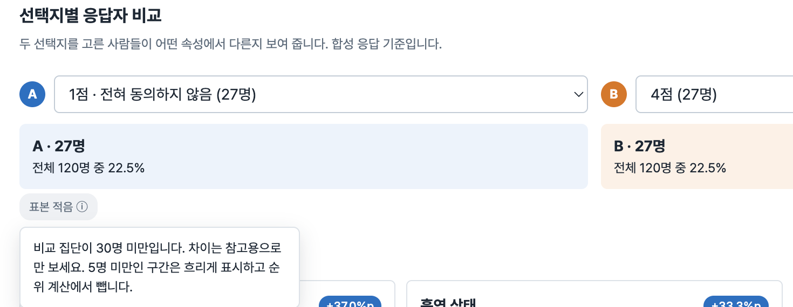

# 변경 기록

커밋 메시지와 `MIGRATION_NOTES.md`를 기준으로 정리했습니다. React 전환(PR #1) 이후의 변경만 다룹니다.

## juno 브랜치 — 2026-10-10

- **UX 흐름 개선** (`fix: ux 흐름 수정`): 설문 → 대상 집단 → 시뮬레이션으로 이어지는 진입 버튼, 읽기 전용 설문 미리보기, 후속 질문 안내, 단계별 준비 상태 문구를 추가했습니다. 결과 화면의 탐색 상태(문항, 응답 선택지, 드릴다운 속성, 나눌 기준, 페르소나, 인터뷰 기준 문항)를 URL 쿼리로 옮겨 새로고침과 뒤로 가기에서 복원되게 했습니다.

## jiyeon 브랜치 (juno에서 분기) — 2026-10-11

2026-10-11 점검 목록의 버그와 UX 세부를 고쳤습니다. 커밋 19개, `npm test`·`npm run build` 통과.

**저장/데이터**
- 빈 상태로 처음 열고 새로고침하면 프로젝트가 바뀌던 버그 수정

**화면 흐름**
- 사이드바와 화면의 설문·대상 집단 상태 표시를 하나로 통일
- 새 프로젝트 첫 화면이 빨간 오류 대신 안내로 시작하도록 변경
- 프로젝트 요약에 설문 → 대상 집단 → 시뮬레이션 진행 상태 추가, 중복 제목 정리
- 대상 집단 조건 변경 경고 중복 제거

**결과 화면**
- 없는 실행 ID로 들어왔을 때 안내 개선(최근 결과로 이동 또는 "찾을 수 없음")
- 모바일에서 집단 분석 표 가로 넘침 수정
- 지역 표기를 전 화면에서 통일(경기도·강원도·전라북도 포함)
- 선택지별 응답자 비교에 지역 지도 추가
- 응답자 비교의 표본 경고를 노란 배너 대신 작은 정보 아이콘으로 변경

 

**문구/표시**
- 실행 번호 뒤 조사("실행 #2이" 등) 전부 수정
- 설문 미리보기 문구, 이전 버전 없을 때 드롭다운 표시 수정

**입력/조작**
- Big5 점수 범위를 한 줄 양방향 슬라이더로 변경
- 모바일 조건 선택 팝업 레이아웃 개선
- 모든 팝업에 키보드 접근성 추가(Tab 순환, Enter 제출, 포커스 복귀)
- 시뮬레이션 화면의 "시연 옵션" 제거

**기타**
- 서비스 이름을 PersonaScope → PersonaLens로 변경

자세한 체크리스트와 확인 방법은 `MIGRATION_NOTES.md`의 `[UX 수정 jiyeon]` 항목을 참고하세요.
